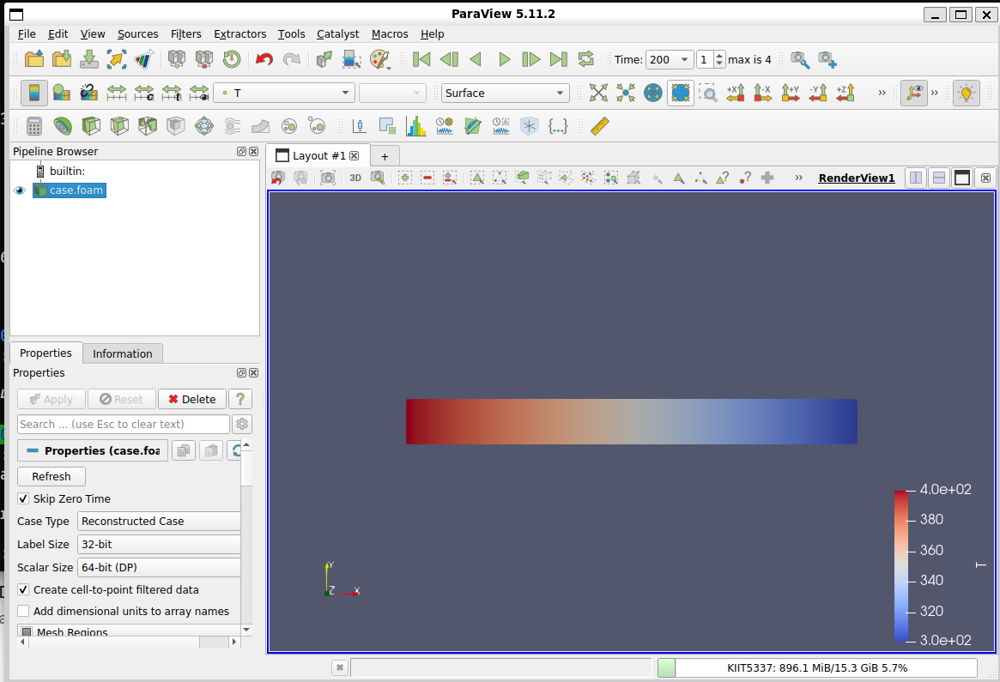
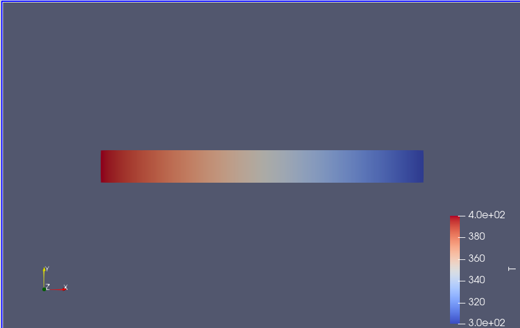

# 1D-Heat-Conduction-Through-a-Bar-using-OpenFOAM-14
This is my version of the IIT Bombay Spoken Tutorial on 1D conduction through a bar. The tutorial was recorded for OpenFOAM 7, but I did it on OpenFOAM 14 (Ubuntu), so a few things had to be changed to get it running. I used `laplacianFoam` for the solve, `blockMesh` for the mesh and ParaView to look at the results.

The problem is simple: a thin bar, one end hot, the other end cold, sides insulated. It's a good first case because you can check the answer by hand.

## Setup

| Item | Value |
|---|---|
| Solver | `laplacianFoam` |
| Bar length | 0.1 m |
| Cross-section | 0.01 m x 0.01 m |
| Mesh | 100 x 1 x 1 cells (`blockMesh`) |
| Initial temperature | 300 K |
| Left end | fixed at 400 K |
| Right end | fixed at 300 K |
| Sides | `zeroGradient` (insulated) |
| Thermal diffusivity (DT) | 4e-5 m²/s |
| Time step | 0.5 s |
| End time | 500 s |
| Write interval | every 100 s |

Since the sides are insulated, heat only moves along x, which is what makes it 1D. Once it settles, the temperature should just be a straight line:

```
T(x) = 400 - 1000 x      (x in metres, T in kelvin)
```

By the end of the run the residual in the log was down around 1e-6 and the solver was doing zero iterations per step, so the bar had basically reached steady state.

## Repository structure

```
openfoam_1D_Conduction/
├── 0/                  initial and boundary conditions (T, DT)
├── 100/ ... 500/       results written every 100 s
├── constant/           physicalProperties, transportProperties, polyMesh
├── system/             blockMeshDict, controlDict, fvSchemes, fvSolution
├── case.foam           empty file so ParaView can open the case
├── log.laplacianFoam   solver output
├── T_contour_100.png   temperature contour at t = 100 s
├── T_contour_200.png   temperature contour at t = 200 s
└── T_contour_300.png   temperature contour at t = 300 s
```

A small note on the properties files: I wasn't sure at first where OpenFOAM 14 reads DT from, so I put it in a few places (`constant/physicalProperties`, `constant/transportProperties` and a `0/DT` field). The solver complained about `constant/physicalProperties` when it was missing, so that's the one that matters. The others are harmless.

## How I ran it

The `controlDict`, `fvSchemes` and `fvSolution` were copied from the flange tutorial that ships with OpenFOAM 14, then I changed the time settings. In v14 that tutorial lives under `tutorials/legacy/basic/laplacianFoam/flange`.

```bash
cd ~/OpenFOAM/kiit-14/run/openfoam_1D_Conduction

blockMesh
checkMesh
laplacianFoam | tee log.laplacianFoam

touch case.foam
paraview case.foam &
```

The time settings I changed in `system/controlDict`:

```
startFrom      startTime;
endTime        500;
deltaT         0.5;
writeControl   runTime;
writeInterval  100;
```

## Post-processing in ParaView

1. Open `case.foam` and click Apply.
2. Change the colouring from Solid Color to `T`.
3. Step through the times (100, 200, 300 ...) and save a screenshot of each.
4. For a T vs x plot, use Plot Over Line from (0, 0.005, 0.005) to (0.1, 0.005, 0.005) and compare it with the straight line above.

The bar is very thin, so it shows up as a long stripe. Zoom in if the colours are hard to see.

## Results

Temperature contours at three times (the left end is the hot one):





## Problems I ran into

- The folder has to be called `constant`, not `constants`. I made it with the wrong name at first and the solver couldn't find `physicalProperties`.
- If you paste file contents straight into the terminal, bash tries to run them as commands. Write them to a file with `cat > file << 'EOF'` or use a text editor.
- My Windows Documents folder is synced with OneDrive, so from Ubuntu the path is `/mnt/c/Users/<name>/OneDrive/Documents/` and not the plain `Documents` path I expected.
- There is no `constants` folder inside the flange tutorial, so you can't just copy one from there. The mesh comes from `blockMesh`.

## Things I might add

- Plot T vs x and overlay the analytical line
- Try a different DT or a mesh with fewer cells to see how much it matters
- Add a heat source term

## Credits

**Pratyush Dash**
